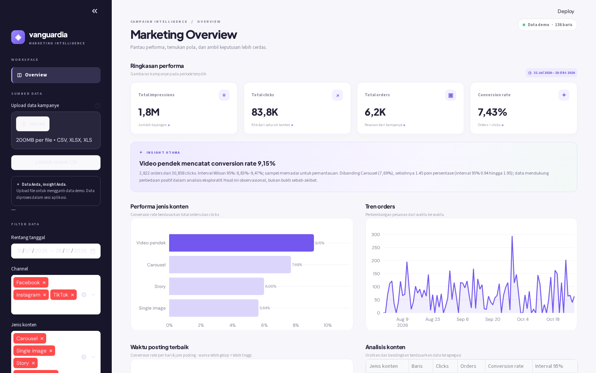

<div align="center">

# ◈ Vanguardia

### Marketing Campaign Intelligence Dashboard

**Ubah data kampanye menjadi insight yang lebih mudah dipahami dan ditindaklanjuti.**

[](https://www.python.org/)
[](https://streamlit.io/)
[](https://pandas.pydata.org/)
[](https://plotly.com/python/)

[Ringkasan](#ringkasan) · [Fitur](#fitur-utama) · [Instalasi](#instalasi-dan-menjalankan-aplikasi) · [Format data](#format-data) · [Metodologi](#metodologi-dan-batasan)

</div>

---

## Ringkasan

**Vanguardia** adalah dashboard untuk menganalisis performa kampanye digital dari file CSV atau Excel. Selain menampilkan metrik dan grafik, aplikasi menjelaskan jenis konten yang menonjol, membandingkan conversion rate, dan memberikan konteks tentang kekuatan data di balik temuan tersebut.

Dashboard menyertakan **data demo sintetis**, sehingga dapat langsung dicoba tanpa menyiapkan dataset.

## Tampilan dashboard



*Contoh tampilan menggunakan data demo sintetis. Angka, tanggal, dan hasil analisis akan berubah sesuai data serta filter yang dipilih.*

## Fitur utama

| Fitur | Kegunaan |
|---|---|
| **Upload CSV & Excel** | Analisis data sendiri, atau unduh contoh CSV dari sidebar sebagai acuan. |
| **Ringkasan performa** | Pantau impressions, clicks, orders, dan conversion rate pada periode terpilih. |
| **Analisis jenis konten** | Bandingkan conversion rate berdasarkan total orders dan clicks setiap jenis konten. |
| **Hari & jam posting** | Jelajahi conversion rate dalam heatmap berdasarkan hari dan jam posting. |
| **Tren orders** | Lihat distribusi orders berdasarkan tanggal posting dari data yang dipilih. |
| **Insight & rekomendasi** | Temukan format dan slot waktu yang menonjol dengan konteks jumlah data dan ketidakpastian. |
| **Filter & ekspor** | Filter tanggal, channel, dan jenis konten; unduh data hasil filter sebagai CSV. |

## Teknologi

- **Python** — bahasa utama aplikasi.
- **Streamlit** — antarmuka dashboard dan interaksi pengguna.
- **Pandas & NumPy** — pembersihan, agregasi, dan perhitungan data.
- **SQLite** — pemfilteran data dalam memori menggunakan SQL.
- **Plotly** — visualisasi interaktif.
- **Openpyxl & xlrd** — pembacaan file Excel.

> Scikit-learn belum digunakan pada versi ini. Model prediktif dapat menjadi pengembangan selanjutnya.

## Instalasi dan menjalankan aplikasi

### Prasyarat

- Python 3.10 atau lebih baru.
- `pip` untuk menginstal dependensi.

### 1. Siapkan proyek

Unduh atau clone repository ini, lalu masuk ke direktori proyek yang berisi `app.py`.

```bash
cd vanguardia
```

### 2. Buat dan aktifkan virtual environment

```bash
python -m venv .venv
```

**macOS / Linux:**

```bash
source .venv/bin/activate
```

**Windows PowerShell:**

```powershell
.venv\Scripts\Activate.ps1
```

### 3. Instal dependensi

```bash
pip install -r requirements.txt
```

### 4. Jalankan dashboard

```bash
streamlit run app.py
```

Buka alamat yang ditampilkan di terminal, biasanya **http://localhost:8501**. Aplikasi otomatis menggunakan data demo sampai Anda mengunggah file sendiri.

## Cara menggunakan

1. Buka dashboard dan amati ringkasan menggunakan data demo.
2. Klik **Unduh contoh CSV** di sidebar untuk melihat format yang didukung.
3. Unggah file **CSV**, **XLSX**, atau **XLS** melalui bagian *Upload data kampanye*.
4. Atur rentang tanggal, channel, dan jenis konten di sidebar.
5. Tinjau metrik, grafik, insight, dan rekomendasi berdasarkan filter tersebut.
6. Buka bagian **Metodologi & format data** di bawah dashboard untuk mengunduh data yang telah difilter.

## Format data

Satu baris merepresentasikan **satu posting atau observasi kampanye**. Nama kolom umum dalam bahasa Inggris, seperti `date`, `content_type`, `platform`, dan `conversions`, juga dikenali.

| Kolom | Status | Deskripsi |
|---|---|---|
| `tanggal` | Wajib | Tanggal posting; boleh menyertakan jam, misalnya `2026-08-13 19:00:00`. |
| `jenis_konten` | Wajib | Jenis atau format konten, misalnya `Video pendek` atau `Carousel`. |
| `clicks` | Wajib | Jumlah klik, berupa bilangan bulat nonnegatif. |
| `orders` | Wajib | Jumlah order, berupa bilangan bulat nonnegatif dan tidak lebih besar dari `clicks`. |
| `channel` | Opsional | Platform atau kanal kampanye. Jika tidak ada, diisi `Tidak diketahui`. |
| `impressions` | Opsional | Jumlah tayangan. Jika tidak ada, diisi `0`. |
| `spend` | Opsional | Biaya kampanye dalam angka. Jika tidak ada, diisi `0`. |
| `revenue` | Opsional | Pendapatan kampanye dalam angka. Jika tidak ada, diisi `0`. |
| `jam` | Opsional | Jam posting, seperti `19` atau `19:00`. Jika tersedia, jam ini digunakan menggantikan jam pada `tanggal`. |

Contoh isi CSV:

```csv
tanggal,jenis_konten,channel,impressions,clicks,orders,spend,revenue
2026-08-13 19:00:00,Video pendek,Instagram,12000,600,48,500000,5760000
2026-08-14 12:00:00,Carousel,TikTok,8500,420,28,350000,3360000
2026-08-15 18:00:00,Story,Instagram,6300,300,18,250000,2160000
```

**Catatan data:**

- Gunakan zona waktu lokal yang konsisten. Jika tanggal tidak menyertakan jam dan kolom `jam` tidak tersedia, waktu dianggap `00:00`.
- Untuk file Excel, aplikasi membaca **sheet pertama**.
- Baris dengan tanggal atau angka tidak valid, angka negatif, clicks/orders bukan bilangan bulat, atau `orders > clicks` akan diabaikan dan jumlahnya ditampilkan di dashboard.
- `spend` dan `revenue` dapat disertakan dalam data dan ekspor, tetapi belum ditampilkan sebagai metrik analisis pada versi ini.

## Metodologi dan batasan

### Conversion rate

```text
Conversion rate = total orders / total clicks × 100%
```

Perhitungan menggunakan **total** orders dan clicks, bukan rata-rata persentase per baris. Conversion rate tidak dihitung jika total clicks adalah nol.

### Seberapa kuat temuan didukung data?

- **Interval Wilson 95%** ditampilkan untuk memperkirakan ketidakpastian conversion rate setiap jenis konten.
- Insight utama memilih conversion rate tertinggi di antara jenis konten dengan minimal **100 clicks dan 20 orders**. Jika tidak ada yang memenuhi ambang, peringkat tertinggi tetap ditampilkan dengan peringatan bahwa sampel terbatas.
- Jika ada setidaknya dua jenis konten yang memenuhi ambang, dashboard membandingkan dua peringkat teratas menggunakan **interval Newcombe 95%** untuk selisih proporsi.
- Ambang tersebut adalah **heuristik**, bukan jaminan signifikansi statistik. Pemilihan kelompok dilakukan setelah melihat data dan tidak dikoreksi untuk banyak pengujian; perbandingan harus dipandang sebagai analisis eksploratif.

### Batasan penting

Interval mengasumsikan clicks independen dan maksimal satu order per click. Pengunjung atau klik berulang dapat membuat interval terlalu sempit. Hasil bersifat **observasional**, bukan bukti sebab-akibat: perbedaan audiens, anggaran, promosi, dan faktor lain dapat memengaruhi hasil. Validasi rekomendasi melalui eksperimen terkontrol sebelum membuat keputusan besar.

## Struktur proyek

```text
vanguardia/
├── app.py                 # Aplikasi Streamlit dan logika analisis
├── requirements.txt       # Dependensi Python
├── README.md              # Dokumentasi proyek
└── assets/
    └── dashboard.png      # Tangkapan layar untuk README
```

## Privasi data

Data yang diunggah diproses oleh aplikasi selama sesi dan digunakan dalam database SQLite **di memori** untuk pemfilteran; kode aplikasi tidak mengirim data kampanye ke layanan eksternal. Saat di-host, data tetap diproses di server tempat aplikasi berjalan. Browser dapat memuat font dari Google Fonts jika tersedia.

---

<div align="center">
  <strong>Vanguardia</strong> · Make every campaign count
</div>
